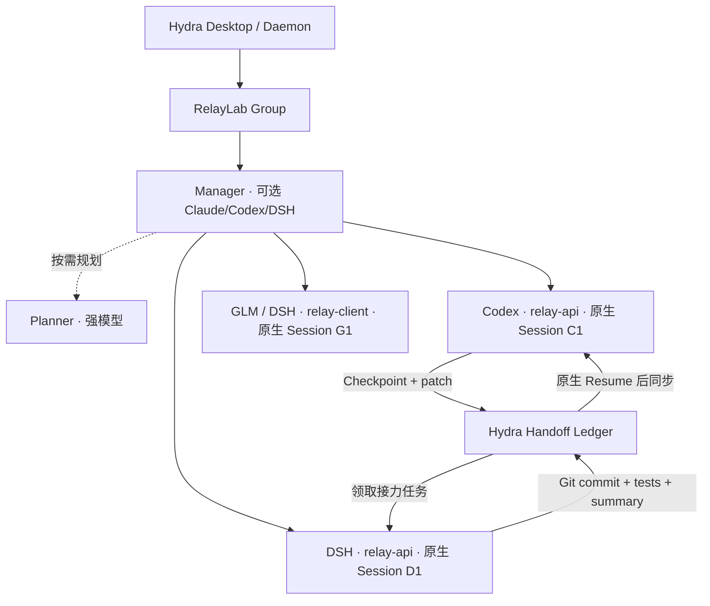

# Hydra RelayLab：跨 Harness Session Group 详细测试计划

**基准仓库**：`lckcjdn/hydra` 的 `main`，审查点 `a6c65690f17f0f87a68b34659b017b5f4e0c1cf9`（2026-10-09）。本计划也适用于后续本地更新版本，但必须记录实际测试的 SHA。

**核心测试主张**：测试的不是“能否生成代码”，而是 **Manager 是否能管理多个真正的原生 Harness Session；额度不可用后，是否保留原 Session 并安全转交代码和任务；额度恢复后，是否能在原 Session 中验证并接续**。

> 该基准提交的 V1 实现包含 Group、Task、Checkpoint、Handoff、手动 Quota 与 UI；**不等于**已实现跨 Harness 自动启动、自动停机/恢复、自动额度检测、自动文件同步与自动规划。测试要记录每一步的状态、实际 CLI 行为和 Git 产物，不能只用 MCP 返回“成功”判断通过。

## 1. 测试拓扑与安全准备



本测试包内包含两个 **独立的 Git 仓库**：`relay-api`（有真实持久化的服务）和 `relay-client`（通过 HTTP 调用 API 的 CLI）。`relay-api` 上的两个 Worker 应使用不同 Git Worktree，或者在接力时先暂停原写入者再串行改动；`relay-client` 与其完全分离。不要在真实研究项目上注入额度故障或模拟崩溃。

### 最低环境

- Windows 10/11、Node.js **20+**、Git；推荐 Windows Terminal / PowerShell 7。其他操作系统也可用。
- Hydra 本体开发环境；至少安装并验证两个独立的 Harness CLI，例如 Codex + DSH；若实际使用 GLM 则从 DSH 模型路由选择 GLM，**DSH 的不同模型不代表独立 Harness 进程实现**。
- 可用的各家认证/额度；测试不能要求真的耗尽额度。首先使用手动 blocked 模拟，其后再用真实限制事件做专项兼容测试。
- 使用**隔离的 Hydra 测试配置/用户数据目录**更安全，避免污染日常 Group/Session；如不能隔离，使用独立测试 Group，不随意清理其他 Session。
- 开启 Hydra 结构化日志；截图、Git 状态、测试退出码收集到 `reports/`。日志中的凭据和提示内容须脱敏。

### 两类检查

1. **产品级**：Hydra UI / MCP / daemon 中的 Session 归属、Task 派发、Quota、Checkpoint、Handoff 和状态持久化是否正确。
2. **工作级**：真实 CLI Session 有没有收到任务、是否实际修改了工作目录、原生 ID 是否保持、Git commits 和自动验收是否通过。两个层级必须分别记录。

## 2. 先跑基线与“故意失败”的验收测试

```powershell
# 在解压包根目录执行（Windows PowerShell / pwsh）
node --version
git --version
pwsh -File .\scripts\init-repos.ps1
node .\scripts\measure.mjs baseline       # 应 exit=0，4/4 PASS
node .\scripts\measure.mjs acceptance     # 应 exit=1，当前仅 1/7 PASS
```

Windows PowerShell 5.1 可用 `powershell -ExecutionPolicy Bypass -File .\scripts\init-repos.ps1` 替换 pwsh。Linux/macOS 用 `bash scripts/init-repos.sh`。

**初始化验收的 RED 状态（特意保留）：**API 接受测试 1/5 通过（不存在 Ticket 的 history 404 是正确响应），另 4 个失败；Client 接受测试 0/2，通过 0 个；共 1/7。不要将初始 RED 判定为 Hydra 故障，也不允许 Agent 为了得到绿灯删除或跳过测试。

当前工程包含:

| Workstream | 独立仓库 | 功能 | 测试文件 | 初始状态 | 最终目标 |
|---|---|---|---|---|---|
| A | relay-api | 过滤、分页、输入校验 | `filtering.test.mjs` | RED | 2/2 PASS |
| B | relay-api | 审计事件、历史、持久化 | `audit.test.mjs` | RED/PASS | 2/2 PASS |
| C | relay-api | CSV 导出/转义 | `export.test.mjs` | RED | 1/1 PASS |
| D | relay-client | stats 与 export CLI | `stats.test.mjs`、`export.test.mjs` | RED | 2/2 PASS |

最终 `node scripts/measure.mjs all` 的两个项目 **基础+验收合计 11/11 PASS**（API: 7；Client: 4），且 `node scripts/integration-check.mjs` 成功。

## 3. 推荐执行流程：先产品操作、后异常接力

### Phase 0：Harness 单体预检（P0）

1. 在 Hydra New Agent 中分别启动真实 Codex 和 DSH Session，让各自在自己的仓库执行 `node --version` 与 `npm test`。
2. 验证 **原生 Session ID、provider/model、cwd**；停止并 Resume 一次，检查是否还是相同原生 Session，而非只出现同名 UI 卡片。
3. 验证 DSH ACP Bridge 正常打印进展、退出后没有留住同一 Session 的写句柄。Windows 上应特别检查孤儿进程。
4. 取最近输出与代码证据；只做 read-only 操作，不改工程文件。

**通过条件**：两种 Harness 都能执行真正工具调用，日志/Session ID 一一匹配，基线测试正确运行；如会话不可 Resume，先修复，不进入交接场景。

### Phase 1：建组与 Session 复用（P0）

1. Hydra → Groups（默认 `Ctrl+Shift+G`）→ Create Group：`RelayLab - Cross Harness`；project refs 设两个真实项目绝对路径。
2. 实际启动 1 个 Manager Session、1 个 Codex Worker、1 个 DSH Worker、1 个跨项目 Worker（GLM 可以走 DSH 的 `llm-pi-ai/...` 路由，具体以本机可用列表为准）。
3. **在 Group 注册上述已真实存在的 Session**，填写 provider、正确 cwd、nativeSessionId 和 role；验证 Group 中所见与 Hydra Agent 页上的进程一致。
4. Manager 选择已有 Codex Session 分配 Workstream A，等待 Task 事件入账后，用同一 Codex Session 接收后续追加需求（如增加非法 offset 检测）。
5. 对比两次任务的 nativeSessionId 和 Agent 进程记录，不允许因为第二次任务就默认启动新 Session。
6. 建立 `relay-client` Worker，检查它不修改 `relay-api` 的仓库。可额外创建一个临时 Group 来验证跨项目逻辑关系。

**特别关注目前 V1**：Groups 的 Add Session 是将一条记录写入 `orchestration.json`，不自动 Spawn CLI；要分开核验「登记成功」和「真实 Agent 正在运行/收到 Prompt」。Manager 的工作区 MCP 配置主要面向 Claude；DSH ACP 客户端在已审查的代码里仍以 `mcpServers: []` 创建 Session。**必须实际验证 DSH Manager 是否拥有 Hydra 调度工具；缺少时列为集成缺陷，而不是自动认定管理成功。**

### Phase 2：主动进展、Checkpoint 与交接（P0）

1. 原 Codex C1 执行 B 的**第一阶段**：只实现持久化 history 字段及测试准备，不实现 HTTP history 路由；参考 `prompts/02-codex.md`。
2. Manager 收集 completed/nextSteps/decisions、Git `HEAD`、branch、dirty paths、测试退出码；调用 `hydra_checkpoint_capture`，再从 Group state 验证确实存在 Checkpoint。
3. 使用手动 Quota blocked 注入（见 Phase 3）；该模拟只标记 `source: manual`，**不伪造“真实账户已耗尽”或重置时间**。
4. 将原 Session 的 Task 通过 `handoff_prepare` + `handoff_accept` 交给独立 DSH Session D1；记录 handoffId 和 Task assignee 的变化。
5. **另外验证真实信息传递**：D1 应确实读取提供的 Git commit/patch + Checkpoint，并能用自己的 Harness 工具完成剩余 API。只改变 Task assignee 字段不算完成。
6. D1 完成后提交 commit/patch，运行 B 验收测试；Manager 调用 `complete`，生成含 Git/测试证据的 Sync-back 摘要。
7. 不应删除 C1，原 Codex 的 nativeSessionId 和 cwd 仍可查。

### Phase 3：额度池与注入（P0）

**建议至少测四组：**

- **Q01 手动 blocked**：将 Codex C1 所属 quota pool 设为 blocked，随后再向 C1 分配新 Task；预期被拒绝，错误信息指出 blocked。可向 DSH D1 派任务。
- **Q02 恢复为 available**：将同一 pool 标记 available；查看状态和 event journal，允许新的调度。**不代表真实原生 Session 已经 Resume**。
- **Q03 不确定/普通限流**：向 Quota signal classifier 输入 `429`、连接超时等；预期不是确凿额度耗尽，不显示捏造倒计时。
- **Q04 同账号多个 Session**：注册另一个 Codex Session 指向同一个 QuotaPool；阻断一次须覆盖两个 Session。若两个 Session 没有绑定同一 pool，这个检查不能视为通过。

**当前接口的一个可测试局限**：`QuotaManager.ensurePool` 在核心代码里存在，但 Groups UI 的 Add Session 表单没有 `quotaPoolId` 输入，也未提供直观的创建额度池按钮。因此如果新 Session 只显示 `no pool`，应记录 UX/接口未闭环。测试可以在**隔离 daemon 测试实例**里通过受控的 `POST /orchestration/quota/observe` 产生测试池，再经 `POST /orchestration/sessions` 将 `quotaPoolId` 指向它；但**不要直接编辑现有生产用户数据中的 JSON**。

### Phase 4：恢复原 Codex Session（P0）

1. 解除**模拟** blocked。确保旧 Session 当前没有运行中的冲突写入任务。
2. 在 Hydra 的原生 Session 入口以 C1 的原始 nativeSessionId、cwd Resume；不能用新的 Codex session “代替”。
3. 检查当前代码树是否包含 D1 的 Git 变更；如果没有，则手动进行明确的 patch/commit 合并并审核冲突，不要假定 `syncBackHandoff` 自动修改文件。
4. 把交接总结（变更、已运行测试、未完成内容）发送给 C1，要求它准确指出 D1 做了什么，验证答案与实际 Git Diff 一致。
5. C1 重新运行 `npm test`、`npm run test:acceptance` 和根目录集成测试，并交付最终审查结果。
6. 验证编排层显示 `resume_pending` 后是否有**真实 provider 校验事件**将其置为 ready/busy；若没有只能判定“记录层恢复成功，真实恢复需人工核实”。

### Phase 5：跨项目并行和真实成果验收（P1）

- GLM（或 DSH 的 GLM 模型路由）在独立 `relay-client` repo 完成 D，Client 验收测试变绿。
- Codex/DSH 分别完成 A、B、C；合并同仓库不同 worktree 时，由唯一负责集成的 Session 审核 Diff 并合并。
- 执行 `node scripts/measure.mjs all` 与 `node scripts/integration-check.mjs`；保存输出为 JSON/日志。
- 新 Task 优先复用现存的原生 Session；强制新开 Session 应记录原因和原/新 sessionId。

## 4. 必跑测试矩阵（每行单独登记证据）

| ID | 维度 | 步骤/注入 | 预期结果 | 级别 |
|---|---|---|---|---|
| S01 | Provider 启动 | Codex/DSH 各运行 baseline | CLI 真实运行、日志可查 | P0 |
| S02 | 原生 Resume | 退出后同 ID/cwd 恢复 | 会话延续而非重开 | P0 |
| G01 | Group | 创建跨项目 Group + 4 Session | Group/Role/成员归属正确 | P0 |
| G02 | Session 复用 | 给同 C1 连续两个 Task | nativeSessionId 不变 | P0 |
| G03 | Manager 权限 | 从 Manager 调 Hydra MCP 工具 | 真的有工具且能调用，不是文本假装 | P0 |
| T01 | 结构化进展 | reportProgress + artifacts | 任务记录/事件/成果一致 | P0 |
| T02 | 回执真实性 | 只发 Prompt 不真正改文件 | 不得被系统算作真正完成 | P0 |
| C01 | Checkpoint | C1 阶段性成果 | gitBase/remaining/decisions 有证据 | P0 |
| Q01 | 手动额度阻断 | pool blocked 后 assign | 正确拒绝原 pool 派工 | P0 |
| Q02 | 额度恢复 | pool available | 解除派发冻结，无假恢复 Session | P0 |
| Q03 | 错误分类 | 裸 429/网络错误 | 不标为确定额度耗尽 | P0 |
| Q04 | 额度池共享 | 两个 Codex session 同池 | 一次 blocked 阻断所有成员 | P0 |
| H01 | Prepare | Codex→DSH | handoffId 与 materials 可追踪 | P0 |
| H02 | Accept | DSH 接力 | Task assignee 更新但 C1 保留 | P0 |
| H03 | 真实工作交接 | DSH 读取 patch 实际编码 | 变更可在 Git 和测试中验证 | P0 |
| H04 | 回流 | DSH→原 Codex | 摘要可用，原生 ID 相同 | P0 |
| R01 | 状态持久化 | 重启 Hydra/daemon | Group、Session、Task、Handoff、journal 不丢 | P0 |
| R02 | 幂等性 | 重复接力/重复 Resume | 不重复创建写入者、不重复提交 | P0 |
| W01 | 写冲突 | 双 Worker 写同 cwd | 冲突可见，禁止静默覆盖 | P0 |
| W02 | Worktree 合并 | 不同分支更改同文件 | 有 Review/解决策略，不强制覆盖 | P0 |
| F01 | Manager 限额或退出 | 中断 Manager | Hydra Core 仍保存状态、可人工恢复 | P1 |
| F02 | DSH ACP 孤儿进程 | Windows 停止 DSH | 不遗留锁住原 Session 的子进程 | P1 |
| F03 | 断电/硬杀 | 停止 daemon 后重启 | 未完成 Task 可恢复且无重复派工 | P1 |
| F04 | UI/IPC 抗压 | 多 Group、多事件快速刷新 | 界面不卡死、状态无错乱 | P1 |
| P01 | 可选 Planner | 强模型规划→Manager 接受 | Planner 不擅自改 Worker 代码 | P2 |
| P02 | 自动 quota | 真实机器可读限额触发 | 仅在本地版本已实现该能力时测试 | P2 |

## 5. 自动化证据与推荐测试方法

### 5.1 三层金字塔

**L1：确定性单元/状态机测试（最低成本，先跑）**

在 Hydra 代码仓库运行 `npm run typecheck` 和 `npm test`；对 Group、Quota、Checkpoint、Handoff 增加非法状态转移、双重 accept、跨组赋权等测试。推荐用已有 Vitest Mock Provider，不涉及真实额度。

**L2：Daemon/MCP 协议集成测试（不依赖模型，推荐最优先补齐）**

用独立用户数据目录启动 Hydra daemon，驱动 `/orchestration/*` REST 或 MCP 工具：创建组→关联 Session→派任务→拦截 quota→接力→回传→重启→检查状态。对每一步断言 HTTP 状态、JSON、事件顺序，尤其测“不只是返回成功”。Windows 支持命名管道时可使用现有 `DaemonClient` 调用，**不建议直接猜测固定监听端口**。

**L3：真实多 Harness E2E（最终不可省略）**

在 Hydra GUI 中运行 Codex、DSH 与 GLM Session，使用 RelayLab 编码任务实现真实成果；按上表人为注入 quota、退出进程、Resume、交接 Git patch，并运行黑盒 API/CLI 验收。记录 native session ID、工作目录、退出码、Git diff 和 test report。这一层能检验原生 session 锁、PTY、ACP、worktree 隔离、权限和文本交接是否有效。

### 5.2 可复现脚本

```powershell
# 基线、待实现功能测试、全套功能与跨 repo 集成
node scripts/measure.mjs baseline
node scripts/measure.mjs acceptance
node scripts/measure.mjs all
node scripts/integration-check.mjs

# 仅读取 Hydra 的编排持久化数据（先使用隔离测试用户目录）
node scripts/audit-snapshot.mjs --state "PATH\TO\orchestration.json" --events "PATH\TO\orchestration-events.jsonl"
```

`measure.mjs` 把两个项目的退出码/通过数/失败数和输出尾部写到 `reports/measurement-*.json`，用于判定 Agent 的代码成果；`audit-snapshot.mjs` 只读检查 Group 成员、Task 归属、Handoff、事件序号和可能的伪恢复状态。两者侧重不同，不能互相替代。

### 5.3 推荐故障注入方式

**优先推荐：手动模拟额度池 blocked + 明确暂停原 Agent 新派工**；可以重复、无实际模型额度耗尽成本。其次是使用 mock quota signal 的单元/daemon 测试。真正触发提供商限额只作为兼容性验证，不应作为每次回归测试的前置条件。

其余注入：不依赖生产数据的 daemon kill/restart、故意制造两个不同 worktree 的同文件冲突、提供一个只有 429 没有 quota 证据的错误、让 DSH Session 在仍被持有写入锁时尝试 Resume（预期拒绝）。

### 5.4 不应使用的通过依据

- `hydra_send_prompt` 返回 success；这只证明消息已提交。
- Agent stdout 停止输出 5 秒；不能证明任务已完成。
- Group 状态显示 `resume_pending`；还没通过原生 CLI 校验。
- `handoff.synced_back` 事件存在；可能只有摘要，没有物理文件合并。
- 随机一个 429；不能直接等同 5 小时额度耗尽。
- 模型自称“全部完成”；必须检查测试、commit、CLI ID 和变更文件。

## 6. 通过门槛与缺陷优先级

**发布闸门（P0 必须全部通过）：**

- Hydra 编排层无 Group 孤儿、Task 跨组所有权错误、Session ID 意外替换、重复接力进程或脏目录静默覆盖。
- 两个 Harness 的真实进程均能创建/停止/原生 Resume，完成至少一次 H01-H04 全流程。
- 额度模拟的 Q01-Q04 正确；没有假额度与假恢复时间。
- `relay-api` 基础+验收 **7/7**；`relay-client` **4/4**；跨仓库集成 **PASS**。
- 至少一次 daemon 重启验证，Group 与 EventJournal 仍保持一致，`audit-snapshot.mjs` 没有错误。
- 关键操作有证据：native Session ID、cwd、Git SHA、Task ID、Handoff ID、明确的命令退出码。

**严重级别：**

| 严重度 | 定义 | 示例 | 处理 |
|---|---|---|---|
| S0 | 破坏数据/越权/失去原 Session | 双 Session 覆盖同目录、误删 worktree | 立即停止测试，禁止发布 |
| S1 | 核心接力错误或虚假状态 | Handoff 只有记录没有交接；resume_pending 当成功 | 阻断发布 |
| S2 | 可绕过的人工交互缺陷 | UI 无法绑定 pool，但可通过安全 API 完成 | 修复后回归；视发行目标决定阻断 |
| S3 | 文字、样式与非核心显示 | 进度文案不清晰 | 排期处理 |

## 7. 时间安排与成本控制（建议 2 个测试轮次）

**第 1 轮：功能验收。**基线 → G01/G02 → T01/T02 → C01 → Q01/Q02 → H01-H04 → R01/W01 → 11/11 功能测试。优先使用两种 Harness，避开真实 quota 耗尽。

**第 2 轮：稳定性。**重启、重复事件、跨项目并行、Manager 中断、DSH 写入锁、UI 持续运行；如已有自动 quota adapter，再测真实 quota 信号。

为控制 Token 预算，Manager 不必每几秒向 Worker 发消息；采用阶段检查点与事件触发更新。每个 Worker 首次只做一个小的、可测试的工作包。`relay-api` 可在独立 worktree 中合并，再运行整套验收。

## 8. 最终测试报告规范

使用 `reports/TEST_RUN_TEMPLATE.md`。每个 Case 一行：实际输入/注入 → 预期 → 实际 → 证据路径 → PASS / FAIL / BLOCKED。不允许把没做的步骤写成 PASS。

建议至少附：Hydra 运行版本 SHA、MCP 工具清单、额度事件前后 JSON、会话原生 ID 证据、两个 repo 的 `git log --oneline -5`、`git diff --stat`、`measurement-all.json`、`integration-check.mjs` 输出、重启前后 `audit-snapshot.mjs` 输出。

**完成定义：**一个 Group 能跨两个项目编排多种 Harness；任务真正执行；额度受限时保留原 Session、其他 Harness 真正接力；额度恢复后在相同原生 Session 中同步 Git 成果并继续，所有验收测试绿灯。这才可称为端到端通过。
